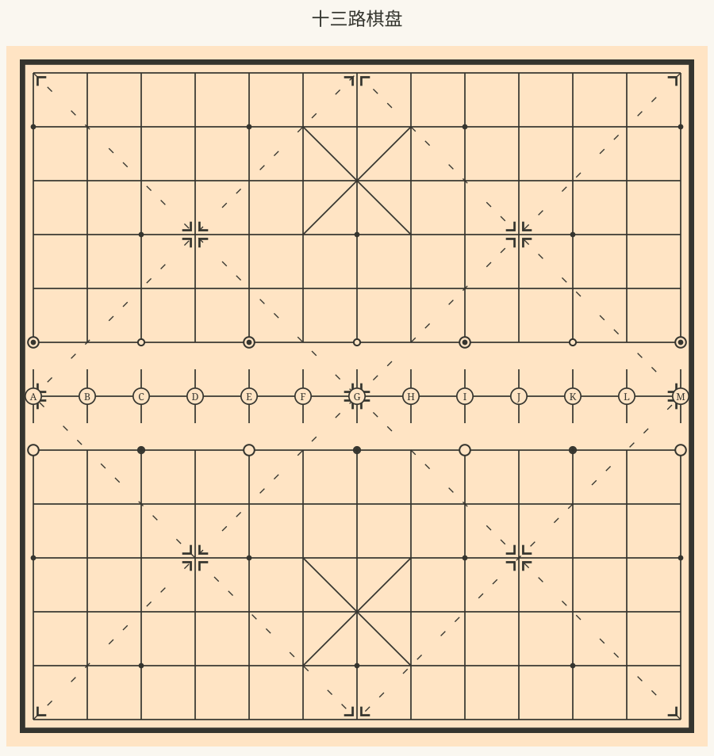
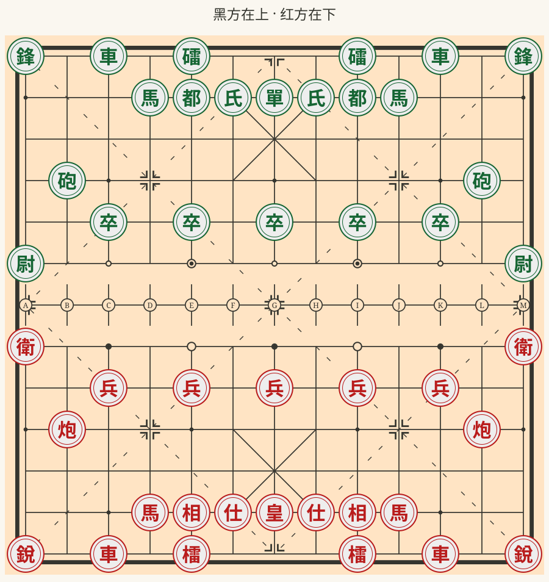
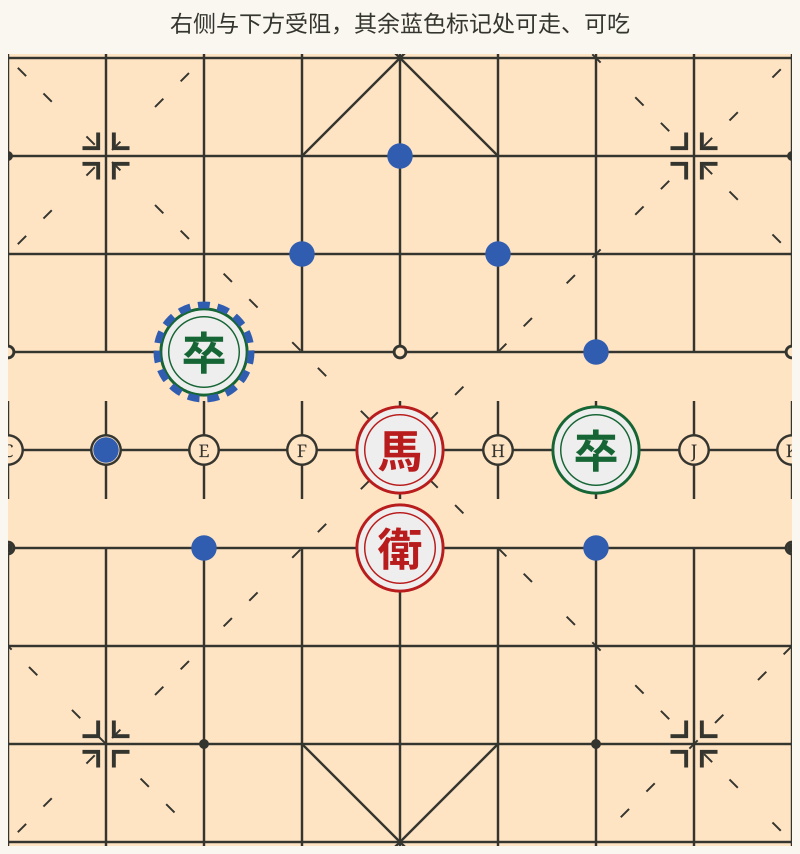
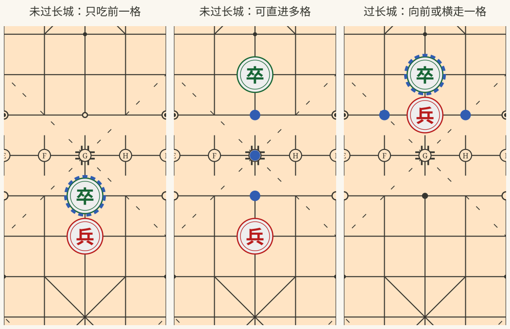
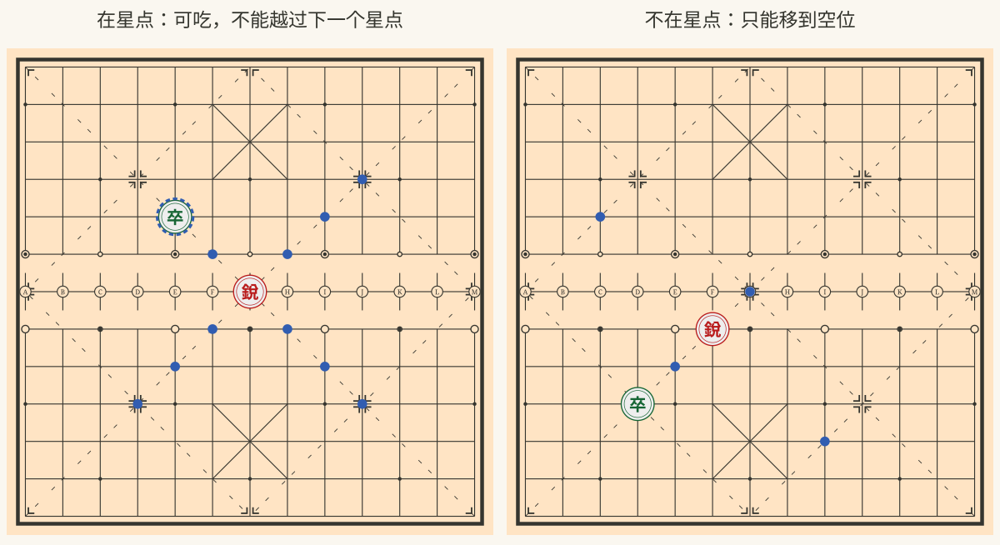
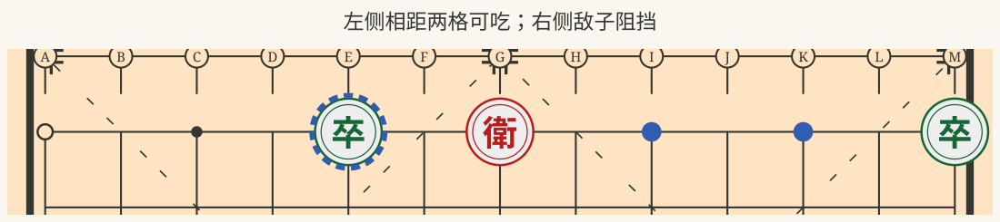
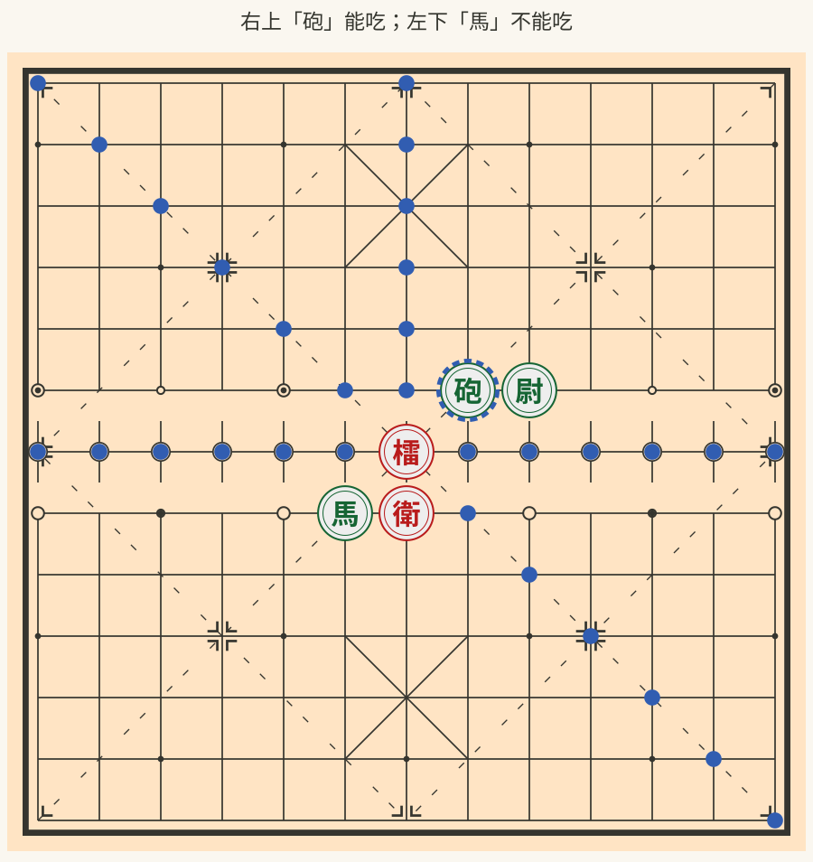

# 匈汉象棋规则

## 一、棋子

红黑双方各有 **10 种、22 枚棋子**，全盘共 44 枚。同一行的红黑棋子走法相同。

| 红方     | 黑方 | 每方数量 |
| -------- | ---- | -------- |
| 皇       | 單   | 1        |
| 仕       | 氏   | 2        |
| 相       | 都   | 2        |
| 馬       | 馬   | 2        |
| 車       | 車   | 2        |
| 炮       | 砲   | 2        |
| 兵       | 卒   | 5        |
| 銳       | 鋒   | 2        |
| 衛       | 尉   | 2        |
| 檑       | 礌   | 2        |
| **合计** |      | **22**   |

## 二、棋盘与摆法

### 棋盘

棋盘有 13 条横线、13 条竖线，共 169 个交叉点。**棋子摆在交叉点上。** 相邻交叉点之间算一格。

以下各图以黑方在上、红方在下的视角展示棋盘。

- 中央第 7 条横线为长城，两侧各有 6 条横线，分别属于双方本阵。
- 每方底部中央、带交叉斜线的 3×3 区域为九宫；九宫底边距离棋盘底线一格。
- 棋盘上的斜虚线供「銳」、「鋒」行走，沿线的十字形标记为星点。
- 长城两侧各有一排空心点，供「衛」、「尉」横行。

### 初始摆法

双方上下对称摆放，如下图。

从**各自底线向长城**数，按下表摆放。列从图的左侧起数，同一行列出的棋子依次对应所列位置。

| 行              | 从左起的列数         | 红方棋子                   | 黑方棋子                   |
| --------------- | -------------------- | -------------------------- | -------------------------- |
| 第 1 行（底线） | 1、3、5、9、11、13   | 銳、車、檑、檑、車、銳     | 鋒、車、礌、礌、車、鋒     |
| 第 2 行         | 4、5、6、7、8、9、10 | 馬、相、仕、皇、仕、相、馬 | 馬、都、氏、單、氏、都、馬 |
| 第 3 行         | —                    | 不摆棋子                   | 不摆棋子                   |
| 第 4 行         | 2、12                | 炮、炮                     | 砲、砲                     |
| 第 5 行         | 3、5、7、9、11       | 兵、兵、兵、兵、兵         | 卒、卒、卒、卒、卒         |
| 第 6 行         | 1、13                | 衛、衛                     | 尉、尉                     |

长城一线上不摆棋子。

## 三、行棋与吃子

1. **红方先走**，双方轮流走一步；每步只能移动一枚己方棋子，不能停着。双方各走一步为一回合。
2. 棋子不能移出棋盘，也不能落在己方棋子占据的位置。
3. 吃子时，取走落点上的敌子，再将己方棋子移到该点。吃子也算一步。
4. 除「炮」吃子需要隔一枚棋子外，任何棋子都不能越过行进路径上的棋子。「马」、「相」另有下述阻挡限制。
5. 每步走完，己方的「皇」或「單」都不能处在下一步会被敌子吃掉的位置；两者也不能处于同一竖线且中间没有棋子的状态。

下列走法图中，**蓝点表示可以移到的空位，蓝色虚线圆环表示可以吃的敌子**。各图只说明相应棋子的走法，实际落子仍须符合以上规则。

## 四、各棋子的走法与吃法

### 皇、單

- 只能在己方九宫内活动。
- 每步横走或直走一格，不能斜走。
- 吃子与走法相同。
- 双方的「皇」、「單」不能在同一竖线上无遮挡相对；也不能移开中间的棋子而造成这种局面。

### 仕、氏

- 只能在己方九宫内活动。
- 每步斜走一格。
- 吃子与走法相同。

### 相、都

- 每步斜走两格。
- 斜线正中间的交叉点必须为空，否则不能走。
- 只能在己方本阵内活动，不能走上或越过长城。
- 吃子与走法相同。

### 馬

有两种走法，吃子与走法相同：

| 走法 | 移动范围                         | 阻挡限制                                   |
| ---- | -------------------------------- | ------------------------------------------ |
| 日字 | 横两格、直一格，或横一格、直两格 | 沿走两格的方向，紧邻起点的一格有子就不能走 |
| 直三 | 横向或纵向走三格                 | 途经的两个交叉点都必须为空                 |

### 車

- 横走或直走任意格，不能斜走。
- 途中不能有棋子。
- 吃子与走法相同；可以吃掉该方向遇到的第一枚敌子，不能越过它。

### 炮、砲

- 横走或直走任意格，不能斜走。
- 不吃子时，途中不能有棋子。
- 吃子时，与目标之间必须**恰好隔一枚棋子**，这枚棋子可以属于任意一方。
- 隔子后不能落在空位，也不能隔两枚或更多棋子吃子。

### 兵、卒

「兵」、「卒」的前进方向是从己方本阵朝向对方本阵，与棋盘展示的朝向无关。「兵」、「卒」始终不能后退，也不能斜走。

| 所在位置                   | 移动                                                             | 吃子                       |
| -------------------------- | ---------------------------------------------------------------- | -------------------------- |
| 未过长城，包括停在长城线上 | 沿本列向前走一格或多格，最远到对方本阵的第一条横线；途中必须为空 | 只能吃正前方紧邻一格的敌子 |
| 已过长城                   | 向前一格，或向左、向右一格                                       | 与移动相同                 |

到达对方底线后，仍可横走，不能后退，也不变成其他棋子。

### 銳、鋒

- 只能沿棋盘的斜虚线移动，途中不能有棋子。
- 每步可停在沿途的交叉点或下一处星点，**不能越过下一处星点**。
- 一步只能沿同一直线移动，不能在途中转弯。
- **从星点出发才能吃子**，吃子范围与该步可走范围相同。
- 不在星点时，只能移到空位；到达星点后，要等下一次行棋才能从该星点吃子。

### 衛、尉

- 只能沿初始所在的那排空心点横行，不能纵走或斜走。
- 不吃子时，可以横走到同排任一空心点，途中不能有棋子；相邻空心点之间相距两格。
- 吃子时，只能吃**左右相邻空心点**上的敌子，即横向相距两格，中间一格必须为空。
- 不能吃相距四格或更远的敌子，也不能越子。

### 檑、礌

- 不吃子时，可以沿横、直、斜八个方向走任意格，途中不能有棋子。
- 吃子时，只能吃周围八个相邻交叉点上的敌子。
- 若目标与「檑」周围八点内的另一枚棋子**横向或纵向紧邻**，就不能吃该目标；斜向相邻不算。
- 这项限制中的另一枚棋子不分红黑，「檑」本身不计入。
- 距离两格或更远的敌子，即使途中为空，也不能吃。

- **能吃「砲」**：右上「砲」虽然与「尉」横向紧邻，但「尉」在「檑」周围八点之外，因此可以吃「砲」，图中用蓝色虚线圆环标出。
- **不能吃「馬」**：左下「馬」与「衛」横向紧邻，且两者都在「檑」周围八点之内，因此不能吃「馬」。

## 五、胜负与和棋

### 取胜

出现以下任一情况，对方获胜：

- 「皇」或「單」正受到攻击，轮到己方时，无法通过任何合法走法解除攻击。
- 轮到己方行棋，没有任何合法走法，即使「皇」或「單」没有受到攻击也判负。
- 一方认输。

「皇」或「單」受到攻击时，必须在这一步解除攻击；不能放任不管。无需实际吃掉「皇」或「單」，即可判定胜负。

### 和棋

- 一方提出和棋，另一方同意。
- 双方都已没有取胜可能。
- 连续 50 回合双方都未吃子，可以提出和棋；核算时，提出方的攻击「皇」或「單」的走子最多计入 10 步。
